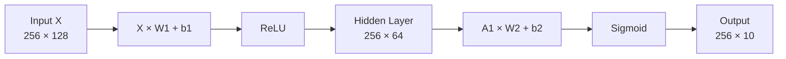
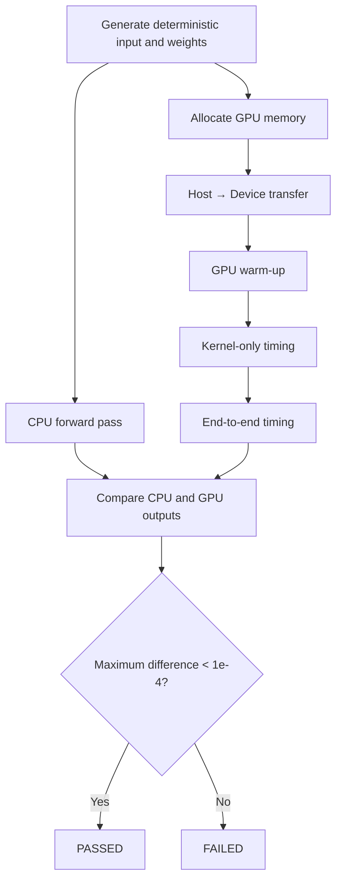
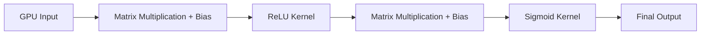
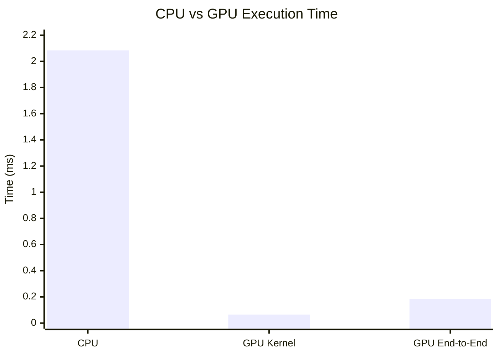
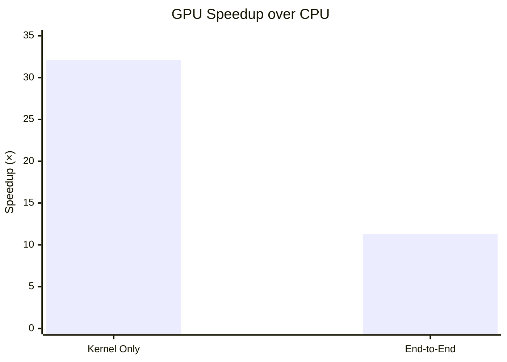
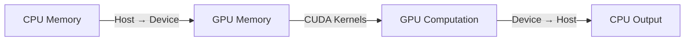

# Neural Network Layers in CUDA

> **Experiment 5 – Parallel and GPU Computing Laboratory**

A CUDA C++ implementation of a **two-layer feed-forward neural network** using custom GPU kernels. The project implements matrix multiplication with bias, ReLU, and sigmoid activation, validates CPU/GPU correctness, and benchmarks GPU acceleration.

##  Highlights

-  Custom CUDA kernels
-  Two-layer neural-network forward propagation
-  Individual known-answer kernel tests
-  CPU vs GPU benchmarking
-  Kernel-only and end-to-end timing analysis
-  Exact observed CPU/GPU validation match
-  **32.13× kernel-only speedup**

---

##  Neural Network Architecture

This project implements **forward propagation only**. It does not include training, backpropagation, loss calculation, or an optimizer.

### Mathematical flow

```text
Z₁ = X × W₁ + b₁
A₁ = ReLU(Z₁)

Z₂ = A₁ × W₂ + b₂
Output = Sigmoid(Z₂)
```

### Architecture diagram



##  Configuration

| Parameter | Value |
|---|---:|
| Batch size | 256 |
| Input size | 128 |
| Hidden layer size | 64 |
| Output size | 10 |
| Timing repetitions | 20 |
| Matrix thread block | 16 × 16 |
| Activation threads per block | 256 |

### Tensor dimensions

```text
Input X       : 256 × 128
Weights W1    : 128 × 64
Bias b1       : 64
Hidden output : 256 × 64
Weights W2    : 64 × 10
Bias b2       : 10
Final output  : 256 × 10
```

Inputs, weights, and biases are generated deterministically using sine and cosine functions so that the CPU and GPU always process identical values.

---

#  Execution Workflow



### GPU pipeline



---

#  CUDA Implementation

The program uses three custom CUDA kernels:

| Kernel | Operation | Parallelization |
|---|---|---|
| `matrixMulBiasKernel` | Matrix multiplication + bias | One thread computes one output element |
| `reluKernel` | `max(0, x)` | One thread processes one element |
| `sigmoidKernel` | `1 / (1 + e^-x)` | One thread processes one element |

### Matrix multiplication

For:

```text
A: M × K
B: K × N
C: M × N
```

each CUDA thread computes:

```text
C[row][col] = Σ A[row][k] × B[k][col] + bias[col]
```

The matrix kernel uses **16 × 16 thread blocks**, while activation kernels use **256 threads per block**.

---

#  Performance Results

The benchmark below was obtained from a run on an **NVIDIA GeForce RTX 2050 (4 GB)**.

| Measurement | Result |
|---|---:|
| CPU average forward-pass time | **2.083975 ms** |
| GPU kernel-only time | **0.064870 ms** |
| GPU end-to-end time | **0.184795 ms** |
| Kernel-only speedup | **32.125205×** |
| End-to-end speedup | **11.277226×** |
| Maximum CPU/GPU difference | **0.000000** |
| Kernel tests | **All Passed** |
| Final validation | **PASSED** |

## Speedup calculation

```text
Speedup = CPU Execution Time / GPU Execution Time
```

Therefore:

```text
Kernel-only: 2.083975 / 0.064870 = 32.13×
End-to-end:  2.083975 / 0.184795 = 11.28×
```

---

#  Graphical Analysis

## 1. Execution time comparison

> Lower execution time is better.



### Interpretation

- The CPU takes approximately **2.08 ms** per forward pass.
- Actual GPU kernel computation takes approximately **0.065 ms**.
- Including memory transfers raises GPU execution to **0.185 ms**.
- The GPU remains substantially faster even when transfer overhead is included.

## 2. GPU speedup comparison



## 3. Relative execution time

Using CPU execution time as the baseline:

| Execution mode | Relative time |
|---|---:|
| CPU | 100.0% |
| GPU Kernel-only | ~3.1% |
| GPU End-to-End | ~8.9% |

### Key insight

The kernel-only benchmark is faster because data is already resident in GPU memory. End-to-end timing additionally includes memory movement and synchronization.

## 4. Memory-transfer overhead



The end-to-end timing includes:

- Host-to-device data transfer
- GPU kernel execution
- Device synchronization
- Device-to-host output transfer

For repeated inference or larger workloads, keeping data and model parameters on the GPU can reduce transfer overhead.

---

#  Validation

Every CUDA operation is tested before the full benchmark.

## Matrix multiplication + bias

```text
A × B = [22 28]
        [49 64]

Bias = [1, -1]

Expected = [23 27]
           [50 63]
```

**Result: PASSED**

## ReLU

```text
Input:    [-2, 0, 3, -4, 5]
Expected: [ 0, 0, 3,  0, 5]
```

**Result: PASSED**

## Sigmoid

```text
Input:    [-2, 0, 2]
Expected: approximately [0.119203, 0.500000, 0.880797]
```

**Result: PASSED**

## Final CPU vs GPU validation

```text
Maximum CPU-GPU difference: 0.000000
Result: PASSED
```

The acceptance threshold is:

```text
Maximum difference < 1 × 10⁻⁴
```

---

# System Configuration

| Component | Configuration |
|---|---|
| GPU | NVIDIA GeForce RTX 2050 |
| GPU Memory | 4 GB |
| Compute Capability | 8.6 |
| NVIDIA Driver | 592.27 |
| CUDA Toolkit Compiler | CUDA 13.4 |
| Operating System | Windows |
| C++ Compiler | Microsoft Visual C++ Build Tools |

The executable was compiled specifically for the RTX 2050 architecture using `-arch=sm_86`.

---

#  Build and Run

## Prerequisites

- NVIDIA CUDA-capable GPU and driver
- CUDA Toolkit with `nvcc`
- Microsoft Visual Studio Build Tools / MSVC
- Windows 10 or Windows 11

Verify your installation:

```cmd
nvcc --version
nvidia-smi
```

### Direct Compilation

Compile:

```cmd
nvcc -O2 -arch=sm_86 neural_network.cu -o neural_network.exe
```

Run:

```cmd
neural_network.exe
```

> If you use a different NVIDIA GPU, use the appropriate CUDA architecture value for that GPU.

### CMake Build (Optional)

```cmd
mkdir build && cd build
cmake ..
cmake --build . --config Release
```

---

#  Repository Structure

```text
pgc_exp5_Neural_Network_Layers_In_Cuda/
├── .github/                 # GitHub Actions workflows
│   └── workflows/
│       └── repository-checks.yml
├── docs/                    # Technical documentation and methodology
│   ├── experiment_overview.md
│   ├── gpu_computing_concepts.md
│   ├── implementation_details.md
│   ├── observations.md
│   ├── performance_methodology.md
│   └── troubleshooting.md
├── results/                 # Benchmarks, logs, and generated charts
│   ├── execution_logs/
│   ├── graphs/
│   ├── benchmark_results.csv
│   ├── benchmark_results.json
│   └── validation_results.json
├── screenshots/             # Visual run verification artifacts
├── scripts/                 # Benchmarking and graph generation scripts
│   ├── capture_screenshots.py
│   ├── generate_graphs.py
│   ├── run_benchmarks.py
│   └── validate_results.py
├── src/                     # Modular C++ & CUDA implementations
│   ├── cpu_validation.cpp
│   └── neural_network.cu
├── CMakeLists.txt           # CMake configuration
├── neural_network.cu        # Complete standalone CUDA implementation
├── run_experiment.bat       # Automated execution batch script
├── .gitignore               # Compiled artifact and secret exclusions
└── README.md                # Documentation, benchmarks, and attribution
```

---

#  Concepts Demonstrated

- CUDA kernel programming
- GPU thread and block organization
- 1D and 2D thread indexing
- GPU memory allocation
- Host ↔ Device memory transfer
- CUDA synchronization
- CUDA event-based timing
- CPU vs GPU performance comparison
- Numerical validation
- GPU architecture targeting

---

#  Attribution and Source Acknowledgment

This project is imported and migrated from:
- **Source Repository**: [Sankalp2772/PGC-L5-NeuralNetwork-CUDA](https://github.com/Sankalp2772/PGC-L5-NeuralNetwork-CUDA)
- **Original Author**: Sankalp Patil (B.Tech Computer Science & AI, KLE Technological University)
- **Destination Repository**: [01fe24bci116/pgc_exp5_Neural_Network_Layers_In_Cuda](https://github.com/01fe24bci116/pgc_exp5_Neural_Network_Layers_In_Cuda)
- **Licensing & Attribution Note**: All original source code, custom CUDA kernels, and documentation originate from the source repository. Attribution is preserved in full compliance with academic integrity and repository licensing terms.
